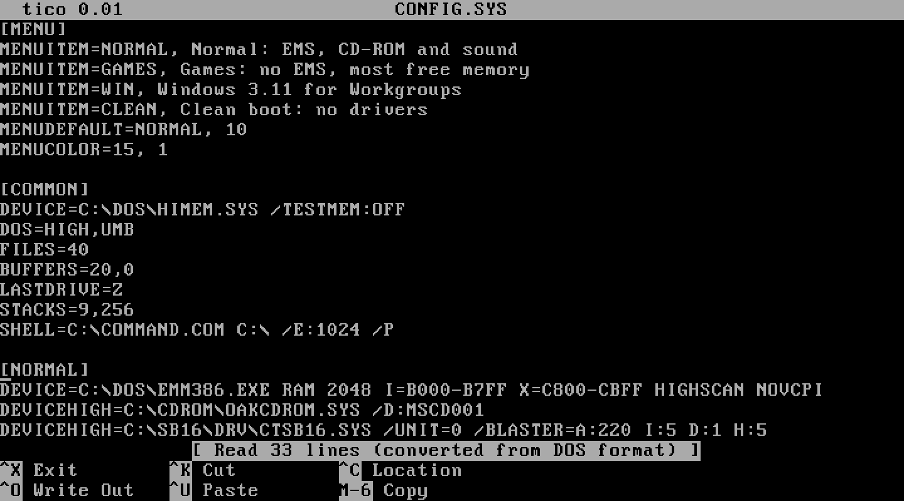

# tico16

## tico for DOS

**tico16** is tico for 16-bit MS-DOS: a small, full-screen text editor
that runs on anything from an original IBM PC with an 8088 up.



It brings tico's look and nano-style keys to DOS. The title bar, status
line and shortcut hints along the bottom look the same as tico's, and
`^O` writes the file out, `^X` exits, `^K` cuts a line and `^U` pastes
it back. If you know nano or tico, you already know how to use it.

```dos
C:\>TICO CONFIG.SYS
```

The goal is simple: make quick edits to files like `CONFIG.SYS` and
`AUTOEXEC.BAT` faster and more pleasant than MS-DOS `EDIT`, even on an
XT-class machine.

### Small and self-contained

tico16 is a single `TICO.EXE` of about 30 KB. There's nothing to
install and no configuration file. It needs no EMS, XMS, mouse or math
coprocessor, and it uses whatever conventional memory is free, so it can
edit files of a few hundred kilobytes. It draws straight into text video
memory to stay responsive on slow hardware, and supports both color and
monochrome displays.

### Your files, left alone

Like tico, tico16 reads and writes DOS (CR LF), Unix (LF) and classic
Mac (CR) text files, keeping each file's format when it saves. That's
handy for vintage machines that trade files with Unix systems or old
Macs. New files are saved in DOS format. Bytes are never converted
between code pages, and a trailing Ctrl+Z end-of-file marker is kept.

Saving is careful too. tico16 writes the new text to a temporary file
first and only replaces the original once that has worked, so a full
disk doesn't cost you the file. Read-only files are refused rather than
overwritten.

### What it leaves out

tico16 keeps only what makes sense on a 4.77 MHz PC. There's no syntax
highlighting, configuration, search, undo, mouse or multiple files.
Keys for commands it doesn't have just say "Unbound key", and the
shortcut hints list only the commands that are there. The
[DIFFERENCES](https://github.com/tico-edit/tico16/blob/main/DIFFERENCES.md)
file has the details.

### Getting it

tico16 is new: version 0.01 is the first release. Download `tico.exe`
from the [releases page](https://github.com/tico-edit/tico16/releases),
copy it to your DOS machine and run `TICO`. The source, built on Linux
with Open Watcom, is at
[github.com/tico-edit/tico16](https://github.com/tico-edit/tico16).
