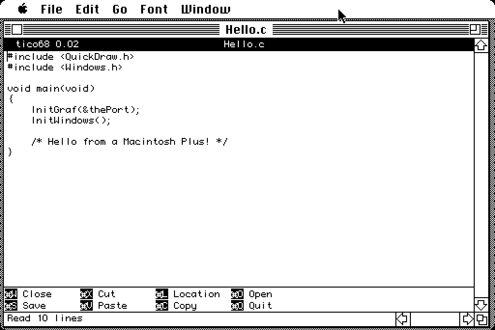

# tico68

[ [tico16](tico16) | [tico68](tico68) ]

## tico for m68k Mac

**tico68** is tico for the classic Macintosh: a small text editor, written
as a real Mac application for the Motorola 68000. It's meant for a
Macintosh Plus with 4 MB of memory under System 6 or System 7.0.1, and
for later Macs that run 68k code.

It's a Mac program first. Each document has its own window with a title
and scroll bars, the menus work the way you'd expect, the mouse selects
text, and Cut, Copy and Paste use the Mac clipboard. You open it by
double-clicking it or a document in the Finder.

The goal is simple: keep the muscle memory of tico and nano on a machine
with a 512 × 342 screen and an 8 MHz CPU, and make quick edits to text
files pleasant without giving up the rest of the Mac.

### Your keys, your choice

Edit → Preferences… chooses one of three keyboard profiles:

* **Macintosh**, the default, has the usual ⌘N, ⌘O, ⌘S, ⌘Q, ⌘X, ⌘C and ⌘V.
* **Tico legacy** has tico's nano-style keys. The Plus has no Control
  key, so ⌘ stands in for Ctrl: ⌘O writes the file out, ⌘X exits, ⌘K cuts
  a line and ⌘U pastes it back.
* **Tico modern** has tico's modern keys, with ⌘S to save and ⌘Q to quit.

The menus stay the same in every profile. Meta is ⌘-Option, or in the
tico profiles Esc (Clear on a Plus keypad) followed by a key. Plain
Option still types MacRoman characters, and with the arrow keys it does
the work of the Home, End and Page keys a Plus doesn't have.

### Made for a small screen

tico's title bar and shortcut bar are on by default, so tico68 looks like
tico. On a Plus you may want those rows for your text: the Preferences
dialog can hide either bar, and the Font menu lists your fixed-width
fonts. The default is Monaco 9.

### Your files, left alone

Like tico, tico68 reads and writes DOS (CR LF), Unix (LF) and classic Mac
(CR) text files, keeping each file's format when it saves. You can change
a document's format from the File menu. New documents are saved in Mac
format. It opens any file, and asks first if the file isn't type `TEXT`.

Saving looks after the rest of the file too. Only the data fork is edited,
so a file keeps its resource fork, type, creator and Finder information.
tico68 writes the new text to a temporary file first, so a full disk
doesn't cost you the file, and a failed save leaves your text in its
window. Locked files are refused rather than overwritten.

### What it leaves out

tico68 has movement, typing, a mark and selections, line cut, copy and
paste, and opening and saving files. There's no help, search, replace,
undo, syntax highlighting or UTF-8. Keys for commands it doesn't have
just say "Unbound key", and the shortcut bar lists only the commands that
are there.

Text is kept in memory. That means a file of about 2 MB at most on a
4 MB Plus under System 6, or about 1 MB under System 7 or MultiFinder
until you raise the application's memory in Get Info. Opening a big file
takes a while: expect about 15 KB a second on a Plus. The
[DIFFERENCES](https://github.com/tico-edit/tico68/blob/main/DIFFERENCES.md)
file has the details.

### Getting it

tico68 is new, and the current version is 0.02. It has been tested under
Mini vMac on System 6 and 7.0.1, and has had a first, good run on a real
Macintosh Plus. It hasn't been tried on any other real Mac yet.

There are two downloads on the
[releases page](https://github.com/tico-edit/tico68/releases):

* `tico68-800k.dsk` is a plain 800K HFS disk image for a Floppy Emu or an
  emulator. It holds the application of about 55 KB and a Read Me.
* `tico68.sit` is a StuffIt archive of the same two files, for a Mac that
  can reach an FTP server. Download it in binary mode, with Fetch for
  instance, and expand it with StuffIt Expander. Version 4.0.1 is tested,
  on System 6 and 7.0.1.

The source, built on Linux with
[Retro68](https://github.com/autc04/Retro68), is at
[github.com/tico-edit/tico68](https://github.com/tico-edit/tico68).
